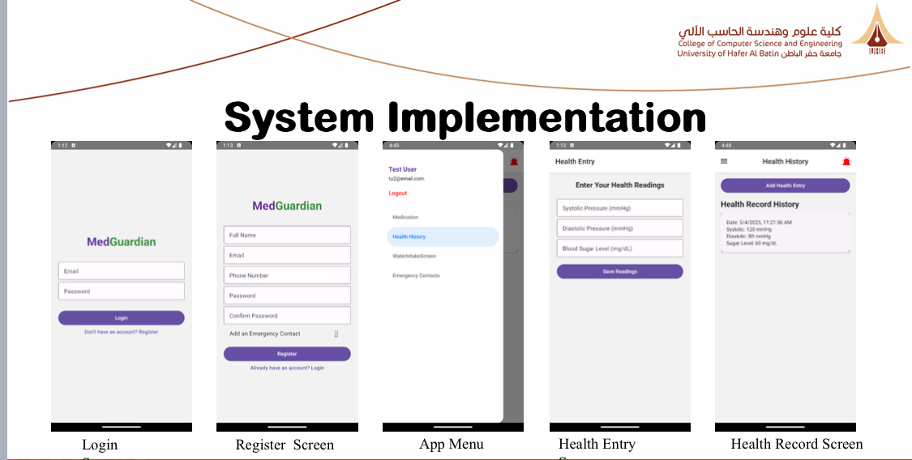
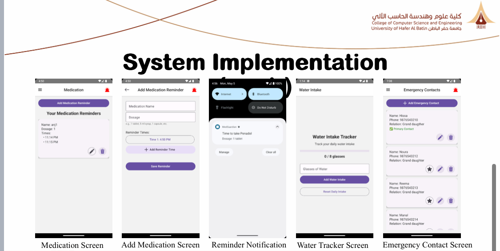

# 🏥 MedGuardian – Smart Elderly Care Application

> A comprehensive mobile application designed to empower elderly users to manage their medications, track vital health metrics, and send immediate alerts during emergencies.

---

## 📌 Project Overview

Elderly individuals often struggle with managing daily medications, tracking vital health parameters (like blood pressure and blood sugar), and maintaining daily hydration—leading to preventable health risks. **MedGuardian** bridges this gap by providing an intuitive, accessible mobile experience tailored for ease of use, ensuring better independence and health management.

* **Project Type:** Graduation Project

---

## 🛠️ Technologies & Tools

* **Framework:** React Native (JavaScript)
* **UI Components:** React Native Paper (Elderly-friendly interface)
* **Navigation:** React Navigation (Stack + Drawer)
* **State Management:** Zustand
* **Local Storage:** AsyncStorage (with Zustand Persist)
* **Form Handling & Validation:** Formik & Yup
* **Notifications:** Push Notifications / Notifee & Background Tasks
* **Hardware Integration (Report Components):** Arduino, Health Sensors, Buzzer, LCD

---

## ✨ Key Features

* 💊 **Medication Reminders:** Multi-time schedules with missed-dose alerts.
* 💧 **Hydration Tracking:** Daily goal setting and water intake logging.
* 📊 **Vital Health Monitoring:** Entry and historical trend tracking for Blood Pressure and Blood Sugar.
* 🚨 **Emergency Alerts:** Quick-trigger emergency button and notification system.
* 📅 **Appointment Management:** Simple tracking for doctor visits.
* 🔒 **Local Data Persistence:** Restores saved user data seamlessly using AsyncStorage.

---

## 👨‍💻 My Contributions

* Developed user interface components and application navigation.
* Implemented state management using Zustand.
* Managed local data storage using AsyncStorage.
* Worked on notification and background task features.
* Contributed to application testing and usability improvements.

---

## 📱 Application Screenshots

---

## 🚧 Challenges & Solutions

* **Usability for Elderly:** Designed simple screens with high contrast and intuitive navigation.
* **Data Persistence:** Integrated `Zustand` with `AsyncStorage` to save state locally.
* **Complex Scheduling:** Managed dynamic local reminders and background notification tasks.

---

## 🔮 Future Enhancements

- [ ] Smartwatch integration for real-time vital tracking.
- [ ] Caregiver / Family member monitoring dashboard.
- [ ] Voice-command navigation and logging.
